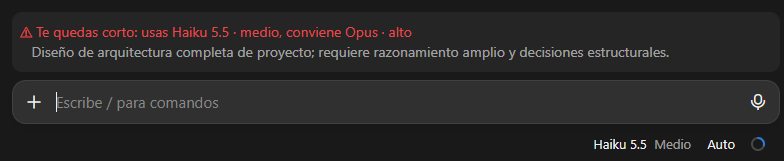
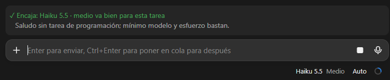
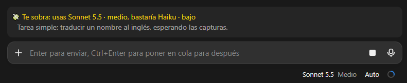

# model-effort

A small mod for Claude Code that answers one question: **is the model I picked the right one for this task?**

Every time you send a message, the mod asks Haiku (cheap and fast) how much model and effort that task needs. Then it compares the answer with the model and effort you are actually using, and shows a one-line verdict right above the prompt box.

## What you will see

| Verdict | Meaning |
| --- | --- |
| ✓ **Good fit** (green) | The model and effort you picked suit the task. |
| 💸 **Overkill** (yellow) | A cheaper model or lower effort would do the job. |
| ⚠ **Too light** (red) | The task needs a stronger model or more effort. |

Under the verdict there is a short reason, in the language of your message.

### Examples

A big task on a small model:



A greeting on a small model:



A simple task on a bigger model:



> The screenshots come from an earlier Spanish-language build. The labels are now in English: *Good fit*, *Overkill* and *Too light*.

## Install

At the prompt of a Claude Code terminal session:

```
/plugin install model-effort --marketplace alejanfh/model-effort
```

Or from a shell:

```
claude plugin install model-effort --marketplace alejanfh/model-effort
```

Say `y` to add the marketplace, then pick a scope. It works in the terminal and in the Code tab of the desktop app.

## How it works

1. You send a message.
2. In the background, the mod sends your message to Haiku (low effort) with a short guide: Haiku for simple things, Sonnet for everyday work, Opus for architecture and hard problems.
3. Haiku answers with the model and effort it thinks are enough, and a short reason.
4. The mod reads the model and effort your session really used and draws the verdict above the prompt box.

The check runs while Claude is already working, so it never delays your message.

## Good to know

- **It is an opinion, not a rule.** Haiku can be wrong. It is told to pick the *minimum* that does the task well, so it will say "Overkill" fairly often.
- **The verdict arrives after you send.** By then the model has already started. Cancelling and re-asking with a cheaper model saves tokens only when the answer is going to be long. Switching models also loses the prompt cache, so for short chats the saving is small. The best moment to use the verdict is at the start of a new session.
- **It costs a little.** Each check is one small Haiku call (low effort, at most 200 tokens of reply). It counts toward your usage.
- Your message is sent to Haiku only to be judged. The mod stores and sends nothing anywhere else.

## Files

- `hooks/register.tsx`: the whole mod.
- `types/index.d.ts`: the type of the values it keeps.
- `.claude-plugin/`: the plugin and marketplace manifests.

## License

MIT
