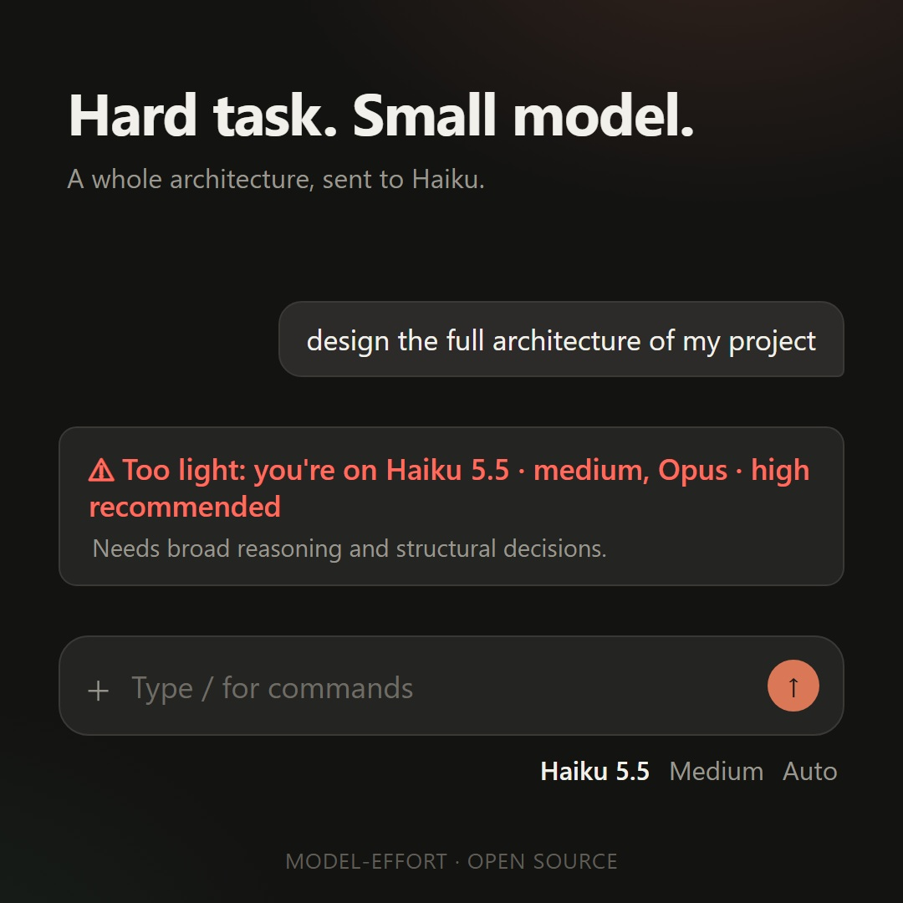

# model-effort

> **Based on Anthropic's guidance** in the article [Which Claude model should you build with? Fable, Opus, Sonnet, or Haiku](https://claude.dev/blog/which-claude-model-should-you-build-with/) by Addy Osmani (claude.dev blog, November 2026). The rules this mod uses to pick a model come from my reading of that article. This is an independent project, not an official Anthropic tool.

[](assets/demo.mp4)

*Click the picture to watch the 37-second demo. It is an animation that recreates what the mod shows.*

A small mod for Claude Code that answers one question: **is the model I picked the right one for this task?**

Every time you send a message, the mod asks Haiku (cheap and fast) how much model and effort that task needs. Then it compares the answer with the model and effort you are actually using, and shows a one-line verdict right above the prompt box.

## What you will see

| Verdict | Meaning |
| --- | --- |
| ✓ **Good fit** (green) | The model and effort you picked suit the task. |
| 💸 **Overkill** (yellow) | A cheaper model or lower effort would do the job. |
| ⚠ **Too light** (red) | The task needs a stronger model or more effort. |

Under the verdict there is a short reason, in the language of your message.

### Examples

A big task on a small model:


A greeting on a small model:


A simple task on a bigger model:


> The screenshots come from an earlier Spanish-language build. The labels are now in English: *Good fit*, *Overkill* and *Too light*.

## Install

At the prompt of a Claude Code terminal session:

```
/plugin install model-effort --marketplace alejanfh/model-effort
```

Or from a shell:

```
claude plugin install model-effort --marketplace alejanfh/model-effort
```

Say `y` to add the marketplace, then pick a scope. It works in the terminal and in the Code tab of the desktop app.

## How it works

1. You send a message.
2. In the background, the mod sends your message to Haiku (low effort), together with the last few messages of the conversation for context and a short guide: Haiku for pure questions, Sonnet for real work with files, commands and debugging, Opus for architecture and hard problems. A short message like "ok, do it" is judged by the work it leads to, not by its length.
3. Haiku answers with the model and effort it thinks are enough, and a short reason.
4. The mod reads the model and effort your session really used and draws the verdict above the prompt box.

The check runs while Claude is already working, so it never delays your message.

## Good to know

- **It is an opinion, not a rule.** Haiku can be wrong, and it only sees your message and the last few messages, not your whole project. It is told to pick the cheapest model that will do the task reliably, and never Haiku for work that needs tools, several steps or debugging.
- **The conversation is sent to Haiku too.** The last few messages (cut short) go along with your request so it can judge the task. Nothing is stored or sent anywhere else.
- **The verdict arrives after you send.** By then the model has already started. Cancelling and re-asking with a cheaper model saves tokens only when the answer is going to be long. Switching models also loses the prompt cache, so for short chats the saving is small. The best moment to use the verdict is at the start of a new session.
- **It costs a little.** Each check is one small Haiku call (low effort, at most 200 tokens of reply). It counts toward your usage.

## Roadmap

What is done and what I think is still missing. Ideas and pull requests are welcome.

**Done**
- [x] Verdict above the prompt box: good fit, overkill or too light.
- [x] Haiku judges each task in the background, in the language of your message.
- [x] The judge sees the recent conversation, so "ok, do it" is rated by the work behind it (v0.3.0).
- [x] Guide that sends real agentic work (files, commands, debugging) to Sonnet, not Haiku.

**Next**
- [ ] Add the **Fable** tier for the hardest work. Today Fable is treated like Opus.
- [ ] Follow the article's order: suggest **raising effort one level before switching model**.
- [ ] Show the verdict **while you type**, before you send, so you can still pick a cheaper model.
- [ ] A settings screen: turn it off, hide the band, pick the judge model, the language, how much conversation it sees.
- [ ] Tests with example prompts, to check that the verdicts stay sensible when the guide changes.

**Ideas**
- [ ] Rough cost estimate: what this task costs on the model you use versus the recommended one.
- [ ] A weekly summary: how often you were on a bigger model than needed.
- [ ] Remember your corrections ("this was fine on Haiku") and learn from them.
- [ ] A screen recording of the real mod to replace the animation.

## Files

- `hooks/register.tsx`: the whole mod.
- `types/index.d.ts`: the type of the values it keeps.
- `.claude-plugin/`: the plugin and marketplace manifests.
- `assets/`: the demo video and the screenshots used in this README.

## License

MIT
